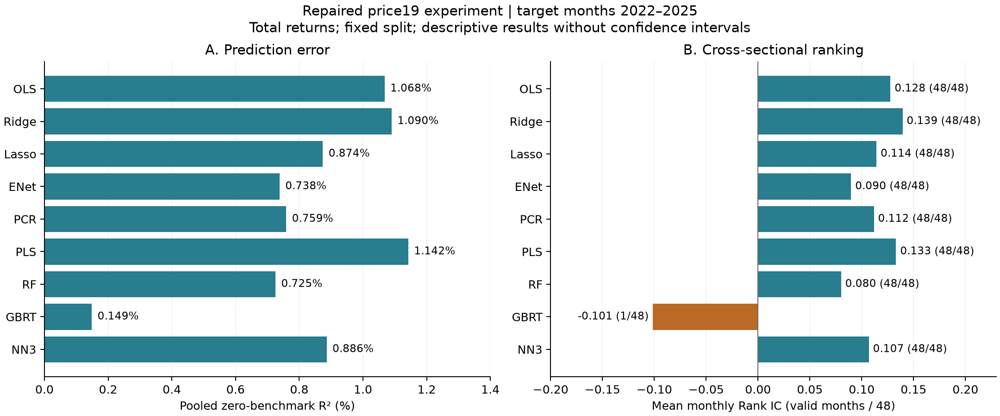

# GKX 框架的模拟复现与 A 股股票收益预测：方法、历史结果和修订审计

**作者：Gilmour Jia**  
研究档案版本：2026-10-25  
文稿类型：持续更新的复现与探索性实证报告；未指定投稿期刊。

## 摘要与阅读路径

本研究围绕 Gu、Kelly 与 Xiu（2020，以下简称 GKX）的机器学习资产定价框架，形成蒙特卡洛模拟、A 股数据处理、多模型预测和结果审计相互连接的研究档案。历史 NN3 实验记录的零预测基准样本外 R² 为 1.0177%，但该值对应旧数据处理与 152 维输入。本轮修订后，以同一 19 特征面板和目标月划分完成九种估计器的比较：测试期为 2022—2025 年，共 212,293 个股票月、48 个月，PLS、Ridge 和 NN3 的相应 R² 分别为 1.1424%、1.0902% 和 0.8862%。这些数值不能解释为同条件修复前后的变化，也没有建立模型差异的统计显著性。GBRT 在 47 个测试月给出截面常数预测，进一步说明预测误差改善和截面排序是不同对象。研究价值在于系统实现、保留失败实验、追踪数据时点与提供可复核计算依据；目前尚不足以证明新的普遍经济规律或可执行净收益策略。

完整、独立撰写的[中英文摘要及关键词](abstracts.md)与本报告配套。为避免把所有实现细节压缩成概述，本档案采用以下分工：

缩写及金融、统计概念另见[术语速查](glossary.md)，审查意见与处理证据见[审查与修改记录](review_summary.md)。

| 文件 | 回答的问题 |
|---|---|
| 本报告 | 为什么做、做了什么、证据支持什么、尚不能说明什么 |
| [方法附录](methods_appendix.md) | 变量和模型究竟如何计算，目标、参数、时间边界、运行接口及实现偏离是什么 |
| [数据字典](data_dictionary.md) | 字段、单位、来源、公式、缺失处理和剩余数据风险是什么 |
| [实验登记表](experiment_registry.md) | 每份历史和新结果对应哪个实验，什么记录存在、什么记录缺失 |
| [修订后结果](repaired_results.md) | 九模型全部计分口径、选中参数、月度指标和组合诊断是什么 |
| [证据清单](evidence_inventory.md) | 历史重要结论的文件来源与证据等级是什么 |
| [数据修订](data_bug_fixes.md)、[模型修订](model_bug_fixes.md) | 发现了哪些错误，修了什么，测试和真实重跑覆盖到哪里 |
| [后续改进重点](../ROADMAP.md) | 下一轮的依赖顺序和具体完成判据是什么 |

## 1. 研究问题与定位

GKX（2020）研究如何以大量公司特征和机器学习方法估计股票风险溢价。把相关框架用于 A 股，需要处理市场制度、信息发布时间、股票覆盖、特征定义、目标收益以及训练安排的差异。将相同模型名称放入 Python 脚本，并不能保证复现的是同一个统计实验；取得一个正的样本外分数，也不能自动说明可交易收益或新增学术贡献。

本研究围绕三个问题展开。第一，能否把原研究的模拟逻辑实现为可执行程序，并观察不同模型在已知信号结构下的误差、变量选择和重要性？第二，在现有公开来源 A 股数据中，六类机器学习方法及线性对照会呈现怎样的预测误差和排序结果？第三，这些数值对数据时点、标签处理、计算定义和实验记录有何依赖，哪些结果仍需重新验证？

本报告把“复现”分为不同层次：实现相应方法、重建模拟设计、再现某一数值、复核历史运行以及检验经济结论。当前工作对这些层次的完成程度不同。已经存在可执行代码和多组历史聚合结果；本轮对 19 特征实验进行了实际重建与重新估计；旧高维 NN3 和全部模拟单元尚未在最终修订代码下完整重跑。本文不把这些状态统称为精确复现成功。

## 2. 已有类似研究与可以借鉴的设计

把机器学习用于 A 股收益预测已有直接相关研究。吴辉航、魏行空和张晓燕（2020）的《机器学习视角下中国股票资产收益率可预测性研究》使用 1997 年 1 月至 2019 年 12 月的 A 股数据和 108 个公司特征，比较 PLS、PCR、Elastic Net、RF、GBRT 与神经网络六类方法。其报告强调中国市场中流动性特征与动量特征表现的差异。Leippold、Wang 和 Zhou（2022）同样研究中国股票市场中的机器学习预测，其摘要讨论流动性、散户参与、预测期限及交易成本。这些先例意味着，“把 GKX 用于 A 股”本身不能作为首次提出的贡献。

本次文献核对主要覆盖上述三篇直接相关研究及所取得的 GKX 附录，不是穷尽式系统综述。关于吴等人的材料，以清华大学官方中文报告为核对对象；其正文附录与另行发布的独立补充材料需要区分。本次没有确认到该中文报告的独立补充材料，因此不补造一个附件，也不把无法访问的其他版本用于方法比较。第三方 PDF 不随本库重新分发。

| 比较维度 | GKX（2020） | 吴等（2020） | 本研究当前状态与借鉴方向 |
|---|---|---|---|
| 研究对象 | 美国股票风险溢价及机器学习比较 | 中国 A 股收益可预测性 | A 股探索性扩展；与已存在的中国市场文献对话 |
| 信息集 | 公司特征及条件信息；具体定义需逐项对齐 | 108 个公司特征 | 历史19/28/71及财务扩展版本；本轮已运行的是19特征，列数不能代替定义一致性 |
| 模型组织 | 多种线性、降维、树和神经网络方法 | 六大机器学习方法家族 | 沿用六家族，同时明确OLS/Ridge/Lasso等估计器变体 |
| 时间设计 | 原文采用随时间更新的估计安排 | 独立的中国市场样本和设计 | 当前固定训练/验证/测试划分；应补年度前推训练，不能称与原文时间设计等同 |
| 收益目标 | 超额收益/风险溢价语境 | 应依据该报告具体公式读取 | 当前下一自然月总收益，未扣无风险利率；需要平行比较总收益与超额收益 |
| 研究解释 | 不同模型及预测信息的比较 | 中国市场特征及可预测性分析 | 先保证信息时点和共同样本，再检验流动性、动量、财务与行业信息的增量 |
| 经济意义 | 预测与资产定价/投资评价相联系 | 需结合其原报告组合设定 | 当前仅毛收益排序诊断；交易成本与实际成交约束尚未闭合 |

可以借鉴的是研究设计，而不是直接移植分数或解释。首先，应以同一预测目标、股票池和月份比较模型；其次，把公司特征逐项映射到经济定义与可用日期，不能以“71、94或108个特征”来判断覆盖完整性；再次，按特征组和时间段分析预测增量，检验流动性与动量在本项目中的作用，而不能把其他论文的结论当作这里已经验证的机制。最后，应同时报告统计误差、排序表现、交易成本及数据限制。

## 3. 研究材料、样本与处理链条

### 3.1 历史材料和证据等级

历史材料包括行情与财务缓存、数据构建脚本、模拟和实证入口、聚合结果以及研究日志。公开档案保留 47 个历史聚合文件：14 个 A 股文件和 33 个模拟文件。文件清单记录 SHA-256 和字节数，可检查公开副本与本次取得的来源文件是否相同。哈希不证明数值正确，也不能恢复旧运行时没有保留的代码、种子、逐轮训练轨迹或原始预测。

证据强度因此不同：真实存在的 CSV 能支持“该次聚合输出记录了这个数值”；运行 manifest 能进一步绑定输入、参数和源码；逐股预测能用于重新计算误差；日志中的口头总结仅能作为历史记录引用。本文不会把这几类证据置于同一层级。

### 3.2 数据来源与建模面板

抓取与处理代码涉及新浪、东方财富以及历史清洗材料中的巨潮资讯等公开访问来源。公开访问不等于获得再分发授权。原始第三方行情、财报、完整特征面板和逐股预测留在本地；公开代码、聚合结果、字段说明和访问路径，详见[数据与代码可用性](data_availability.md)。

| 数据对象 | 股票月行数 | 股票数 | 月数 | 含义 |
|---|---:|---:|---:|---|
| 旧原始月收益缓存 | 639,085 | 5,236 | 192 | 本次读取到的原始资产规模 |
| 旧特征面板 | 628,113 | 5,080 | 191 | 历史处理产物，不能直接冒充修订面板 |
| 本轮修订特征面板 | 639,255 | 5,210 | 192 | 形成月2010-01—2025-12；含尚不符合模型资格的预热行 |
| 本轮当期符合资格行 | 517,152 | 见数据字典及构建记录 | 见构建记录 | 当前月有观测、至少10条日线、至少24个有观测的历史月 |
| 合格且下一月标签可得的建模样本 | 510,500 | 5,070 | 168 | 目标月2012-01—2025-12，进入训练/验证/测试 |

形成月和目标月必须分开。月末形成特征 $z_{i,t}$，预测下一自然月总收益 $r_{i,t+1}$。若下一自然月缺失，标签保留缺失，不跳接到未来另一个有观测月份。训练、验证和测试均按目标月划分。名义训练配置是2010—2018，但历史资格要求使本轮有效训练目标月从2012-01开始：

| 集合 | 实际目标月 | 月数 | 股票月数 |
|---|---|---:|---:|
| 训练 | 2012-01—2018-12 | 84 | 178,488 |
| 验证 | 2019-01—2021-12 | 36 | 119,719 |
| 测试 | 2022-01—2025-12 | 48 | 212,293 |

19个基础特征覆盖价格、动量、风险、交易活跃度、股本与股息等信息；完整公式、回溯窗口、输入字段与代理定义列在数据字典和方法附录。缺失特征经过明确的预处理，不能被解释为源数据完整。原始市值另存，避免把排名后的市值特征错误用于组合权重。

本轮另公开了19特征×3个样本段的[57行缺失统计](../results/repaired/feature_missingness/feature_missingness.csv)，分母为最终合格且有标签的模型样本，统计排名前的非有限值。36个月动量`mom36m`在训练、验证、测试段分别有46.99%、23.12%、8.52%的观测需要中性排名填补；24个月资格门槛并不保证36个月特征可得。此补充没有重新估计模型，不能据缺失比例直接推断模型优劣的原因；应进一步检验缺失处理与窗口资格的敏感性。

### 3.3 时点和覆盖仍有哪些限制

本轮修订了全样本收益缩尾、跨缺月标签、目标月边界、部分财报滞后、TTM依赖和行业聚合中的问题，并对默认实证采用未缩尾总收益。财务扩展中的历史报表版本无法凭当前快照恢复，相关入口需要明确的探索性风险选项；本轮19特征结果没有使用完整财务扩展、行业哑变量或宏观交互。

冻结构建器仍有“全文件日线少于60行则跳过”的入口条件。核查发现本次26只被这一条件排除的股票只有2025年第四季度1—3个月历史，没有可满足24个月资格的股票月；但由于特征缩尾先于最终资格过滤，移除入口条件可能间接改变截面阈值。本文保留该残余条件及实际执行版本，不把零直接合资格排除解释为完全无影响。下一轮需要移除入口条件、明确缩尾参考池并完整重建。

退市覆盖、真实上市与ST历史、配股及其他公司行动、股本记录的当时可得性仍有未闭合项。冻结输入的收益范围为−77.4447%至+1083.4190%；保留极值有助于避免以测试信息改善分数，但其经济真实性仍需逐案审计。

## 4. 六类方法与公平比较的含义

本项目以六类方法组织研究：偏最小二乘（PLS）、主成分回归（PCR）、弹性网（Elastic Net）、随机森林（RF）、梯度提升回归树（GBRT）和神经网络（NN）。OLS是线性基线，Ridge与Lasso是额外正则化对照，模拟中的Oracle依赖已知生成机制。方法家族数、模型变体数和运行次数是不同概念。

| 方法 | 作用与估计思路 | 本研究需特别披露的选择 |
|---|---|---|
| PLS | 构建与响应相关的低维成分再预测 | 成分数由验证损失选择；不能把成分解释为因果因子 |
| PCR | 先按特征协方差提取主成分，再回归 | 标准化、成分数、数值秩与零奇异值处理 |
| Elastic Net | 通过L1/L2惩罚控制线性模型复杂度 | 惩罚网格、L1比例、截距和训练标准化；另报Ridge/Lasso |
| RF | 对随机化回归树进行集成 | 树数、深度、候选特征数、叶节点样本和随机种子 |
| GBRT | 逐步拟合残差或相应损失的梯度 | 损失、学习率、深度、树数、叶规模以及预测退化情况 |
| NN | 多层非线性映射并通过网络集成预测 | 网络结构、正则化、学习率、早停、调参与最终种子、失败网络 |

本轮九估计器使用相同面板、相同目标月划分和同一测试样本，因此具备共同样本的描述性可比性。这并不表示所有模型拥有相同调参预算，也不意味着当前网格已充分搜索各模型能力。具体目标函数、全部代码网格和选中参数见方法附录与运行manifest。

本轮RF和GBRT均为100棵树、最小叶节点100。NN3采用32–16–8隐层，惩罚候选为 $10^{-5},10^{-4},10^{-3}$，学习率候选为0.01和0.1；使用种子0、1的平均预测验证误差选参，再用100、101、102三个种子构建最终集成。选中惩罚为0.001、学习率0.1；最大60个epoch，三个网络保存的最佳epoch均为2。当前记录没有保留每个候选的验证MSE及逐epoch轨迹，不能从最终配置反推缺失信息。

当前训练安排是固定切分，不是每年滚动或扩展窗口重新估计。模型选择使用验证期，但测试期在整个研究过程中已被反复查看，不能称为全新未触碰留出集，也不能将同一测试期上的多次改进当作独立确认。

## 5. 蒙特卡洛模拟：已经实现什么，尚未对齐什么

模拟模块为研究提供了真实市场之外的检查环境。已知数据生成过程能够区分线性与非线性信号，并观察无关协变量、维度和模型容量对预测及变量选择的影响。本项目保存了线性与非线性DGP、50/100个基础特征的四个主要格子，并包含公司特征与宏观状态交互形成的设计矩阵。DGP方程、参数和实际源码定义详见方法附录。

历史档案包括Table A.1风格的预测比较、A.3变量选择频率、A.4变量重要性，以及3/6/12月预测期限实验。树和NN主要聚合文件中有每单元100次重复的记录；GLM、期限和敏感性实验不都具有相同重复次数。不能把“某些单元100次”扩大为“所有结果100次”。

例如，在线性DGP(a)、50个基础特征的历史输出中，Ridge、RF、GBRT、NN3和Oracle的OOS R²分别为3.9697%、3.6488%、3.7470%、4.0974%和5.5409%。这些是本项目历史模拟结果，不是A股实证结果。非线性DGP(b)、100个基础特征的RF和GBRT分别记录3.2331%和3.4236%，而NN3存在与论文结果明显不一致的情形。保留这些偏离比只展示接近原文的单元更有助于诊断。

需要纠正的一项历史引用错误是：GKX附录中的RF/GBRT 3.35%和OLS 1.14%位于模拟Table A.1，不能拿来作为美国真实市场预测成绩对照A股结果。模拟与真实样本还可能使用不同R²基准，必须从各自定义出发比较。

本轮发现并修订了Huber组模型加权、PCR秩亏、多期限标签跨集合重叠等实现问题。多期限 (h>1) 的训练和验证尾部各移除 (h-1) 个形成期，避免相邻集合共用标签收益冲击；单月划分保持原有边界。这是当前项目的防重叠协议，不宣称原论文只允许这一种实现。

A3续跑原先把方法组名与具体模型名混用，且A3/A4可隐式向已有文件追加，存在重复计数风险。本轮修订了这些行为并加入针对性测试。历史聚合文件没有据此被自动改写：缺少逐次原始记录时，无法仅凭最终均值判断是否受过重复追加影响。完整模拟重跑仍是待补项目。其他续跑与合并入口也有配置绑定限制，使用方法见附录，不能把所有入口统称为完整实验管理系统。

## 6. 如何解释 R²、IC 和组合结果

对测试样本集合 $\mathcal T$，零预测基准的合并样本R²定义为

$$
R^2_{\mathrm{OOS},0}=1-\frac{\sum_{(i,t)\in\mathcal T}(r_{i,t+1}-\hat r_{i,t+1})^2}{\sum_{(i,t)\in\mathcal T}r_{i,t+1}^2}.
$$

结果CSV把该比例乘以100显示。例如1.02%表示平方预测误差相对零预测基准减少约1.02%，不是年化收益、方向预测准确率或排序相关系数。由于当前标签为总收益，零预测基准还与收益总体水平有关。

测试样本中心化R²的分母使用测试期自身均值；训练均值基准R²使用仅由训练样本得到的均值；等月平均R²先在每月计算再对月份平均。它们的权重和比较对象不同，不能同名替换。测试样本均值是事后统计量，不是“可实现的历史均值预测”。

IC为每月预测与实现收益的Pearson截面相关系数，Rank IC为相应Spearman相关系数。常数预测没有截面排序信息，相关系数应记为未定义，不能填零，也不能把少数有效月的均值标成全期稳定表现。本轮对常数小数预测的浮点判别作了修复，并在公开表中记录有效月份数。

组合诊断按预测排序形成十分位高低组合，分别报告高组、低组、多空差及市场等权对照。它们使用未缩尾实现收益，仍是毛收益：交易成本、滑点、涨跌停、T+1、实际成交与融券可得性未建模。总收益均值/波动率明确标为假设rf=0的比率；多空差也未被重构为具有完整保证金、融资与资金账户的策略。

## 7. 历史 1.02% 与树模型探索

### 7.1 历史 NN3 的身份

[`ashare_v2_nn71.csv`](../results/historical/ashare/ashare_v2_nn71.csv)记录NN3输入152列，说明材料将其分解为71个公司特征和81个行业虚拟变量。样本内、验证和测试零基准R²分别为2.6949%、1.3848%和1.0177149183600132%；测试样本中心化R²为0.4138%。选中L1惩罚为0.0001，学习率为0.1。

这一记录足以支持“历史实验曾报告约1.02%”的说法。它的研究意义在于展示了一个可继续追查的非线性预测结果，并促使研究进一步审查信息集、正则化和评估方法。它尚不支持“已确认无泄漏”“可实现相应投资收益”或“优于原论文”的结论。旧标签经过全样本收益缩尾，月份按特征月切分，完整历史运行代码和逐轮记录没有全部冻结；这些问题都需要在同条件或明确改变条件的新实验中处理。

另外一份156列Lasso结果记录1.0517%，属于不同财务特征版本。它既不能替代NN3复现，也不能证明两个模型没有共同数据偏差。日志中的Ridge组合比率约2.41又属于第三个历史实验，缺少相应冻结明细，不能写成NN3的投资收益。

### 7.2 回归树探索的价值

| 历史设定 | RF OOS R²（%） | GBRT OOS R²（%） |
|---|---:|---:|
| 19行情特征 | 0.2964 | −0.9247 |
| 19行情+9财务特征 | 0.5859 | −0.3176 |
| 71公司特征+行业，共153列 | 0.5501 | −1.4689 |
| 152列、RF叶规模100、100棵树 | 0.5788 | 未报告 |

这些结果保留了特征扩展和容量选择的探索过程，也保留了不成功的模型。各行同时可能改变样本、实现和模型设置，不能把差异归因为单个财务特征组，也不能以GBRT负分断言树模型在A股普遍无效。RF与GBRT并不是同一种估计器；观察到两者差异后，应检查目标函数、验证选择、叶规模和预测分布，而不是仅以模型家族给结论。

## 8. 修订后的共同样本结果

本轮将九模型拆成两个运行tag执行，但输入文件、核心模型源码和划分相同。所有模型均在同一212,293行测试面板上计分；详细样本、哈希、环境、参数、四种R²及IC在[修订后结果](repaired_results.md)和[`results/repaired`](../results/repaired/README.md)中披露。

| 模型 | 合并样本零基准测试 R²（%） |
|---|---:|
| OLS | 1.067898 |
| Ridge | 1.090155 |
| Lasso | 0.874013 |
| Elastic Net | 0.738241 |
| PCR | 0.759130 |
| PLS | 1.142372 |
| RF | 0.725349 |
| GBRT | 0.148764 |
| NN3 | 0.886238 |

图1：相同19特征实验的点估计。左图为零预测基准R²，右图为月度Rank IC均值，括号为有效月数。没有置信区间或模型差异显著性检验；GBRT仅1个月有效，不能与其他模型48个月的均值作同等稳定性解释。图由公开聚合CSV生成，脚本为[`plot_repaired_results.py`](../scripts/plot_repaired_results.py)。

PLS和Ridge在该次零基准误差比较中取得较高数值，NN3为0.8862%。本轮结果没有证明更复杂模型一定更好，也没有证明线性模型普遍更适合A股。总收益定义、固定切分、特征质量、网格范围和重复查看测试期共同限制了可外推范围。

GBRT的零基准R²为正，但训练均值基准R²约为−0.4920%。同时，47/48个月的截面预测为常数；只有2025-05相关系数有定义，Pearson IC为−0.1562，Rank IC为−0.1014。因此应优先诊断模型输出为何退化，不能把单月负值解释成持续负排序。这一事实也说明，是否改善平方误差与是否能区分同月股票不是同一个问题。

Ridge的高组、低组和多空差月均毛收益分别约为2.2498%、−1.0087%和3.2585%；多空差rf=0年化均值/波动率约2.1742。NN3的多空差月均毛收益约2.3672%，对应比率约1.9092。它们是已计算的组合诊断，尚不具备可执行账户意义；尤其不能直接与日志中的旧Ridge约2.41相减，解释为某个修复导致的策略损失。

## 9. 修订、测试和可复核程度

本轮修订覆盖标签自然月、目标月划分、收益缩尾污染、排名公式、训练行业词表、财报精确季度滞后、TTM完整依赖、行业历史聚合、日除权特征、beta归一化、原始市值、神经网络验证目标、PCR秩亏、Huber组模型加权以及组合指标等。数据和模型修订文件逐项说明原问题、修改行为及仍未解决部分。

验证分为三层。第一，36项针对性回归测试通过，检查已经识别的代码错误及边界输入；合成面板例子运行了Ridge、RF、GBRT和NN1。第二，对真实19特征面板执行了冻结源码后的全量重建，两次输出逐字节一致。第三，从本地两份逐股预测严格按股票、形成月和目标月一一匹配，检查真实收益与市值一致，再重新计算九模型误差、432条模型月统计及Ridge/NN3组合诊断。

九模型合并样本R²的重算与模型指标最大偏差约为2.22×10⁻¹⁴个百分点。这里的数值一致性支持公开汇总与预测明细的计算关系；不能据此宣称源数据真实、所有历史实验可重现或所有模型实现完全等同原论文。测试通过也不消除残留的股票覆盖、公司行动及历史版本问题。

构建面板和估计模型使用了不同依赖环境，分别记录于manifest和requirements说明中。没有声称在全新环境里重新安装所有精确版本并完成了端到端复现。当前代码公开可读，合成流程可运行；基于原始第三方数据的完整复建还依赖用户合法取得输入及处理未闭合的数据问题。

审查后仅修改了构建器的模块说明，收窄未经核实的信息时点保证，未改执行语句。实际运行过的构建器字节副本单独保留，旧/新源码哈希及去除模块说明后抽象语法树相同的检查见[说明文字修订记录](../results/repaired/source_annotation_revision.json)。冻结构建记录仍绑定原执行版本，不因注释修改回填历史哈希。

## 10. 研究亮点、局限与后续项目

本研究已有公开归档价值。价值不取决于是否比另一个项目文件更多，也不只取决于1.02%这一成绩。模拟代码使研究者能够在已知机制下检查模型；多方法和多特征版本保留了比较路径；负结果与偏离记录避免只呈现冠军；修订结果把数据、源码、参数、预测汇总与文字主张连接起来。上述内容能被他人阅读、检查和继续改进，构成一份有用的复现研究基础。

若要进一步主张新的资产定价结论，需要更强的设计和证据。最直接的缺口是：历史数据可得性与退出收益未充分恢复；总收益目标未与超额收益对齐；固定切分未与年度前推对照；历史测试期存在反复查看；模型差异缺少不确定性和多重选择调整；交易成本与可成交性缺失；旧高维NN3及部分模拟单元缺少完整运行冻结记录。

后续工作应遵循依赖顺序。先解决会改变标签、股票池和信息可用日期的问题，再冻结共同面板，完成年度前推和样本池稳健性；随后以月份为时间单位研究误差差异、年度稳定性和极端月影响，不能把几十万股票月当成独立重复；在此基础上做流动性、动量、财务与行业特征消融，最后评估可执行多头及具备明确融资条件的多空组合。

完整优先级、工作内容和验收条件独立维护在[ROADMAP](../ROADMAP.md)。它是下一轮计划，不是对既有研究的事前注册。每次改变数据或实现，都应保留旧结果身份并增加新版本，而不能用新代码覆盖旧成绩的来源。

## 11. 数据、代码及研究声明

**Data Availability。** 本库公开经过选择的历史与修订聚合结果、字段说明、参数、哈希和数据访问路径。第三方原始行情与财务数据、完整逐股特征和预测未重新分发。完整分类、访问限制和待确认项见[数据可用性声明](data_availability.md)。没有申请或编造数据DOI。

**Code Availability。** 研究与修订代码位于本项目`research/`、`scripts/`和`tests/`。原研究者的文献署名、方法来源和第三方权利保持不变。仓库公开可见并不自动构成授予开源许可证；本轮没有擅自替作者选择许可证。

**作者贡献。** Gilmour Jia为本研究文稿和项目代码的署名作者，承担研究问题与研究方向的确定、原研究实施及最终研究判断。Codex本轮协助代码核查、局部修订、实验执行、证据整理、图表和文字审查。具体AI协助在文末披露，不作为作者署名或独立人类评审。

**资助与利益冲突。** 本次材料未提供可确认的资助项目或利益冲突信息，故不编造资助编号，也不将“未提供”替换为作者已经声明“无”。正式投稿前应由作者补充确认。

**伦理说明。** 本报告使用股票市场及公司层面数据，不报告人体受试者实验。材料未提供机构伦理审批或豁免文件；本报告不声称获得此类审批。数据访问和许可义务仍须单独遵守。

## 参考文献

Gu, S., Kelly, B., & Xiu, D. (2020). Empirical asset pricing via machine learning. *The Review of Financial Studies, 33*(5), 2223–2273. https://doi.org/10.1093/rfs/hhaa009

Leippold, M., Wang, Q., & Zhou, W. (2022). Machine learning in the Chinese stock market. *Journal of Financial Economics, 145*(2), 64–82. https://doi.org/10.1016/j.jfineco.2021.08.017

吴辉航、魏行空、张晓燕（2020）。*机器学习视角下中国股票资产收益率可预测性研究*（清华大学金融科技研究报告，2020年第12期，总第65期）。清华大学金融科技研究院。https://thuifr.pbcsf.tsinghua.edu.cn/info/1013/2112.htm

## AI 协助披露

本研究文稿及项目代码的作者为 **Gilmour Jia**。Codex在本轮协助整理证据、审查与修订代码、执行部分验证和重跑、生成图表及撰写和核对文稿。DeepSeek在既有研究中的辅助作用依据作者陈述及历史记录注明；本轮没有调用DeepSeek服务，不声称由其完成本轮独立审核。多角色AI审查仍可能具有相关错误，不等于独立人类同行评审或外部认证。作者保留最终研究决策、发布审阅及责任。
